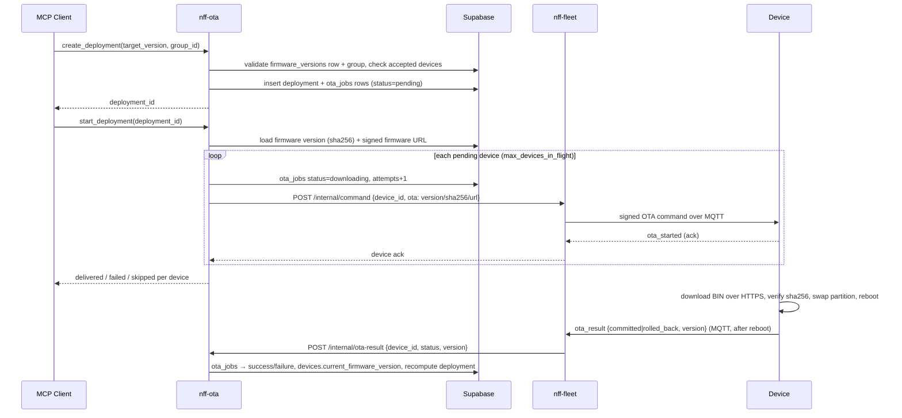

# nff-ota

Mender-inspired **Over-The-Air firmware update manager** exposed as an [MCP](https://modelcontextprotocol.io) server. Manages firmware artifacts, IoT device lifecycles, device groups, and phased deployments — backed by Supabase (PostgreSQL + Storage).

---

## Overview

`nff-ota` lets an AI agent (or any MCP client) orchestrate IoT fleet firmware rollouts end-to-end:

1. **Upload** a firmware artifact, identified by its **version** (SHA-256 checksum, optional Ed25519/RSA-PSS signature). The version must be a 3-part semver (e.g. `2.0.0`) — the device's anti-downgrade check rejects anything it can't parse as `≥` its current firmware.
2. **Register & authenticate** devices through a pending → accepted lifecycle
3. **Group** accepted devices for targeted rollouts
4. **Deploy** a firmware version (`target_version`) to a device group, with configurable concurrency and retry limits
5. **Push** the update — `nff-ota` is the OTA brain; it asks **nff-fleet** to deliver the signed command to each device over MQTT
6. **Finalize automatically** — when a device reboots onto the new firmware it reports an `ota_result`; nff-fleet forwards it back to nff-ota, which marks the device `success`/`failure`, advances `devices.current_firmware_version`, and rolls the deployment up to `finished`

Deployments auto-finalize when all devices reach a terminal state, driven by the device-reported **`ota_result` feedback loop** (with a timeout reaper as a backstop for devices that never report). Devices that were preauthorized are accepted automatically on first contact.

> **Shared schema.** nff-ota does not own a separate database — it shares the Supabase project with **nff-fleet** / the dashboard and reuses their tables: a device is a row in `devices` (its OTA enrollment lives in the `ota_status` column, distinct from fleet's connectivity `status`); a firmware artifact is a row in `firmware_versions` (keyed by `version`, with the deployable BIN + checksum); per-device update progress is a row in `ota_jobs`. nff-ota adds its own `device_groups`, `device_group_members`, and `deployments` tables.

> **nff-ota decides, nff-fleet delivers.** nff-ota never talks to devices directly — the only wire to a device is nff-fleet's MQTT broker. When you start a deployment, nff-ota builds the OTA command (version, sha256, pre-signed firmware URL) and calls nff-fleet's `POST /internal/command`; fleet signs it and pushes it over MQTT. nff-fleet does **not** make any OTA decisions — it only sends commands.

---

## Architecture

```
MCP Client (Claude / any host)
        │  streamable-http :3002 (MCP protocol)
        ▼
  nff_ota/server.py  ──  FastMCP + lifespan (reaper) + webhooks (custom_route)
        │
  ┌─────┴───────────────────────────────────┐
  │  tools/      resources/   webhooks.py    │
  │  artifacts   artifacts://  POST /internal/ota-result
  │  devices     devices://                  │
  │  deployments deployments:/ reaper.py     │
  │  groups      device-groups: (stuck-job timeout)
  └──┬───────────────────┬────────────────▲──┘
     │ supabase-py(async)│ httpx           │ ota_result (HTTP, from fleet)
     ▼                   ▼                 │
  Supabase project    nff-fleet  ──────────┘ (command-delivery plane)
   ├── PostgreSQL       POST /internal/command ── signs + MQTT push ─→ device
   │   (shared w/ fleet:                                                 │
   │    devices, firmware_versions, ota_jobs    ota_result over MQTT ◀───┘
   │    + nff-ota's device_groups / deployments)
   └── Storage bucket
       (firmware/<version>.bin)
```

---

## OTA update flow



---

## Delivery via nff-fleet

nff-ota has no device channel of its own. `start_deployment` delivers each OTA command
through **nff-fleet**'s `POST /internal/command` endpoint (authenticated with the shared
`OTA_FLEET_SECRET`). Fleet signs the `ota|version|sha256|nonce|timestamp` payload with its
command key and publishes it over MQTT.

**Device identity mapping.** nff-ota keys devices by Supabase UUID (`devices.id`), but
fleet addresses devices by their MQTT identity (the client-certificate CN, e.g.
`device-42`). Record that identity when registering a device, under
`identity_attributes.mqtt_id`:

```jsonc
register_device(identity_attributes={ "mqtt_id": "device-42", "mac": "..." })
```

`start_deployment` resolves `identity_attributes.mqtt_id` for each device; devices without
it are reported as `skipped` (nothing is delivered for them).

See [`docs/OTA_ROADMAP.md`](docs/OTA_ROADMAP.md) for what is intentionally deferred
(phased-rollout gates, crash→diagnosis routing).

---

## OTA result feedback loop

`start_deployment` only delivers the command and records the device's immediate
`ota_started` ack — the *final* outcome arrives asynchronously, minutes later, after the
device downloads, flashes, and **reboots** onto the new firmware. This loop closes that gap
without any manual step:

1. On the new firmware, the device publishes `{"type":"ota_result","status":"committed"|"rolled_back","version":...}` to its MQTT response topic (`nff/devices/{id}/response`).
2. **nff-fleet**'s router recognises the `ota_result` payload type and forwards it (fire-and-forget) to nff-ota: `POST {OTA_FLEET_URL→nff-ota}/internal/ota-result`, authenticated with the shared `X-Fleet-Secret`.
3. **nff-ota**'s `POST /internal/ota-result` endpoint (in `webhooks.py`) calls `finalize_ota_result`, which locates the device's active `ota_jobs` row by `(device_id, target_version)` and sets it `success` (committed) or `failure` (rolled_back). On success it advances `devices.current_firmware_version`; either way it recomputes the deployment, which rolls up to `finished` once all jobs are terminal.

`finalize_ota_result` is **idempotent** (a repeat or an already-terminal job is a no-op) and trusts the device's reported outcome directly — it deliberately does *not* run step-by-step transition validation, since the job is parked in `downloading` and the device authoritatively reports the terminal state.

**Reaper (backstop).** A device that downloads but never reports (bricked, or rolled back without reconnecting) would otherwise leave its job in `downloading` forever. A periodic sweep (`reaper.py`, started in the server lifespan) marks any job stuck in `downloading` past `OTA_DOWNLOAD_TIMEOUT` as `timed_out` (a terminal state) and recomputes its deployment.

> To activate the loop, set `NFF_FLEET_OTA_URL` on nff-fleet (pointing at nff-ota, e.g. `http://localhost:3002`) so fleet knows where to forward. `report_device_status` remains as a manual override for advancing a device's stage explicitly.

---

## Prerequisites

- Python ≥ 3.12
- A [Supabase](https://supabase.com) project (free tier works)
- Service-role API key for the project

---

## Installation

```bash
git clone <repo>
cd nff-ota
pip install -e ".[dev]"
```

---

## Database setup

Run the migration against your Supabase project (once):

```bash
# via Supabase CLI
supabase db push

# or paste supabase/migrations/0001_initial.sql directly in the SQL editor
```

`0001_initial.sql` is **additive**: it ALTERs the existing fleet/dashboard tables
(`devices` += enrollment columns, `firmware_versions` += deployable-image columns,
`ota_jobs` += deployment linkage) and CREATEs nff-ota's own `device_groups`,
`device_group_members`, and `deployments` tables. Apply the nff-fleet / nff-dashboard
schema first, since this migration extends it.

The private storage bucket named `artifacts` (or whatever you set `OTA_ARTIFACT_BUCKET`
to) is provisioned automatically by nff-db migration `0091_ota_artifacts_bucket.sql`,
so `npm run db:migrate` creates it on every project — no manual step. If you point
nff-ota at a bucket name other than `artifacts`, create that bucket by hand (private).

---

## Configuration

Copy the example and fill in your credentials:

```bash
cp .env.example .env
```

| Variable | Default | Description |
|---|---|---|
| `OTA_SUPABASE_URL` | — | Supabase project URL (required) |
| `OTA_SUPABASE_KEY` | — | Service-role secret key (required) |
| `OTA_ARTIFACT_BUCKET` | `artifacts` | Storage bucket name |
| `OTA_LOG_LEVEL` | `INFO` | Python log level |
| `OTA_DEFAULT_MAX_DEVICES_IN_FLIGHT` | `10` | Concurrent device update limit |
| `OTA_DEFAULT_MAX_RETRIES` | `3` | Max retry attempts per device |
| `OTA_TRUSTED_SIGNING_KEY_PATH` | *(empty)* | Path to Ed25519 public key for artifact verification |
| `OTA_FLEET_URL` | *(empty)* | Base URL of nff-fleet's command-delivery endpoint (e.g. `http://localhost:3001`) — required to push updates |
| `OTA_FLEET_SECRET` | *(empty)* | Shared secret sent as `X-Fleet-Secret` (outbound to fleet) **and** validated on the inbound `/internal/ota-result` webhook; must match nff-fleet's `NFF_FLEET_MCP_SECRET` |
| `OTA_FLEET_TIMEOUT` | `120` | Seconds to await a device's response to an OTA command |
| `OTA_DOWNLOAD_TIMEOUT` | `600` | Seconds a job may sit in `downloading` before the reaper marks it `timed_out` |
| `OTA_REAPER_INTERVAL` | `60` | How often the stuck-job reaper sweeps |

> The inbound feedback loop is driven from **nff-fleet**: set `NFF_FLEET_OTA_URL` on the fleet side to nff-ota's base URL (e.g. `http://localhost:3002`) so fleet forwards `ota_result` messages here.

---

## Running

```bash
nff-ota        # starts the streamable-http MCP server on 0.0.0.0:3002
```

Or via the module:

```bash
python -m nff_ota
```

Host/port are configurable via `OTA_MCP_HOST` / `OTA_MCP_PORT` (default `0.0.0.0:3002`).

### MCP client config (Claude Desktop / claude-code)

Register it over HTTP (the server must already be running):

```bash
claude mcp add nff-ota --transport http http://localhost:3002/mcp
```

---

## MCP surface

### Tools

#### Artifacts
| Tool | Description |
|---|---|
| `upload_artifact` | Upload a firmware BIN for a given `version` — stores it at `firmware/<version>.bin`, computes SHA-256, optional Ed25519 signing; upserts the `firmware_versions` row |
| `list_artifacts` | List firmware versions that carry a deployable binary, filter by `device_type` or `version` prefix |
| `delete_artifact` | Un-register a version's artifact (removes the BIN + clears its deployable fields; blocked if referenced by an active deployment) |

#### Devices
| Tool | Description |
|---|---|
| `register_device` | Enroll a device by its real fleet `device_id` (auto-accepts if preauthorized; sets enrollment fields on the shared `devices` row) |
| `preauthorize_device` | Pre-register a device for automatic acceptance on first contact |
| `accept_device` | Move device from `pending` → `accepted` |
| `reject_device` | Move device to `rejected` |
| `decommission_device` | Permanently retire a device (cascades to abort active deployments) |
| `list_devices` | List devices, filter by status or group membership |

#### Device Groups
| Tool | Description |
|---|---|
| `create_group` | Create a named device group with optional filter criteria |
| `add_devices_to_group` | Add devices to a group (idempotent) |
| `remove_devices_from_group` | Remove devices from a group |
| `list_groups` | List all groups with member counts |

#### Deployments
| Tool | Description |
|---|---|
| `create_deployment` | Create a deployment targeting a firmware `target_version` + device group (devices start `pending`) |
| `start_deployment` | Push the firmware: build the OTA command and deliver it to each pending device **via nff-fleet** |
| `get_deployment_status` | Aggregated status with per-device breakdown |
| `abort_deployment` | Abort a scheduled or active deployment |
| `list_deployments` | List deployments, filter by status |
| `report_device_status` | Manually advance a device's update stage (a manual override; final outcomes normally arrive automatically via the `ota_result` feedback loop) |

### Resources (read-only metadata)

| URI | Description |
|---|---|
| `artifacts://v1/{version}` | Firmware version metadata + checksum |
| `devices://v1/{device_id}` | Device details + recent deployment history |
| `deployments://v1/{deployment_id}` | Deployment status + per-device breakdown |
| `device-groups://v1/{group_id}` | Group details + member count |

### Guided prompts

| Prompt | Description |
|---|---|
| `ota_deployment_workflow` | Step-by-step workflow: upload → verify group → deploy → monitor |
| `fleet_rollout_plan` | Phased canary → early-adopter → broad rollout strategy |

---

## State machines

### Device lifecycle

```
pending ──────────────────────────────────┐
preauthorized ──→ accepted ──→ rejected   │
                          └──→ decommissioned (terminal)
```

More precisely:

| From | Allowed transitions |
|---|---|
| `pending` | `accepted`, `rejected` |
| `preauthorized` | `accepted` |
| `accepted` | `rejected`, `decommissioned` |
| `rejected` | `accepted` |
| `decommissioned` | *(terminal)* |

### Deployment lifecycle

| From | Allowed transitions |
|---|---|
| `scheduled` | `active`, `aborted` |
| `active` | `paused`, `finished`, `aborted` |
| `paused` | `active`, `aborted` |
| `finished` | *(terminal)* |
| `aborted` | *(terminal)* |

### Per-device deployment stages

```
pending → downloading → installing → rebooting → success ✓
                  ↓           ↓          ↓
               failure ←──────────────────  (retries back to pending)
```

The `ota_result` feedback loop sets the terminal `success`/`failure` directly from the device's reported outcome (it does not walk the intermediate `installing`/`rebooting` steps); the reaper sets `timed_out`. The step-by-step transitions above still apply to the manual `report_device_status` path.

Terminal states: `success`, `already-installed`, `aborted`, `decommissioned`, `failure` (max retries reached), `timed_out` (reaped).

---

## Artifact storage

`upload_artifact` reads the firmware **BIN** from `file_path` (on the server) and stores a single object per version in the Supabase Storage bucket:

| Object | Path | Purpose |
|---|---|---|
| BIN | `firmware/<version>.bin` | The flashable image — served to devices via a pre-signed URL |

The SHA-256 checksum and optional Ed25519 signature recorded on the `firmware_versions` row are computed over that BIN. At `start_deployment`, nff-ota mints a short-lived **pre-signed** Supabase Storage URL and embeds it in the OTA command; the device downloads the BIN directly from the storage edge and verifies the sha256 before swapping partitions.

---

## Cryptographic artifact signing

Artifacts can be signed at upload time and verified at download time.

```python
# Sign at upload by pointing at an Ed25519 private-key PEM file on the server
upload_artifact(..., sign_key_path="/path/to/ed25519_private.pem")

# If OTA_TRUSTED_SIGNING_KEY_PATH is set, every upload MUST be signed and is
# verified against that trusted public key before the artifact is registered.
```

---

## Testing

```bash
# Unit tests — no Supabase needed
pytest tests/unit tests/integration -v

# End-to-end — requires a real Supabase project in .env
pytest tests/e2e -v
```

The e2e suite exercises the full lifecycle: upload artifact → register 3 devices → accept → group → deploy → all devices report success.

---

## Project structure

```
nff_ota/
├── server.py          # FastMCP server entry point, lifespan (starts reaper)
├── config.py          # OtaSettings (pydantic-settings, OTA_ prefix)
├── client.py          # Supabase async client singleton
├── crypto.py          # SHA-256, Ed25519, RSA-PSS
├── transitions.py     # State machine validation
├── storage.py         # Supabase Storage upload/download/delete (keyed by version)
├── fleet.py           # HTTP client → nff-fleet POST /internal/command (outbound)
├── webhooks.py        # Inbound POST /internal/ota-result (feedback loop)
├── reaper.py          # Periodic stuck-job timeout sweep
├── models/            # Pydantic models (Artifact, Device, Deployment, Group)
├── tools/             # MCP tool implementations
│   ├── artifacts/
│   ├── devices/
│   ├── deployments/   # incl. finalize_ota_result (feedback-loop finalizer)
│   └── device_groups/
├── resources/         # MCP resource endpoints
└── prompts/           # Guided workflow prompts
supabase/
└── migrations/
    └── 0001_initial.sql   # extends shared fleet tables + creates groups/deployments
tests/
├── unit/              # Pure logic, no I/O
├── integration/       # Mocked Supabase client
└── e2e/               # Real Supabase project required
```

---

## License

Internal — IntraMap Carto R&D.
